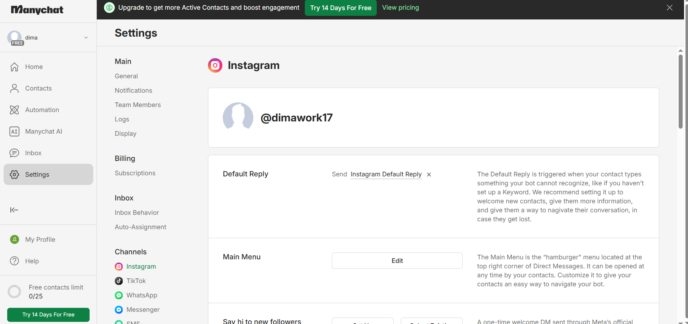
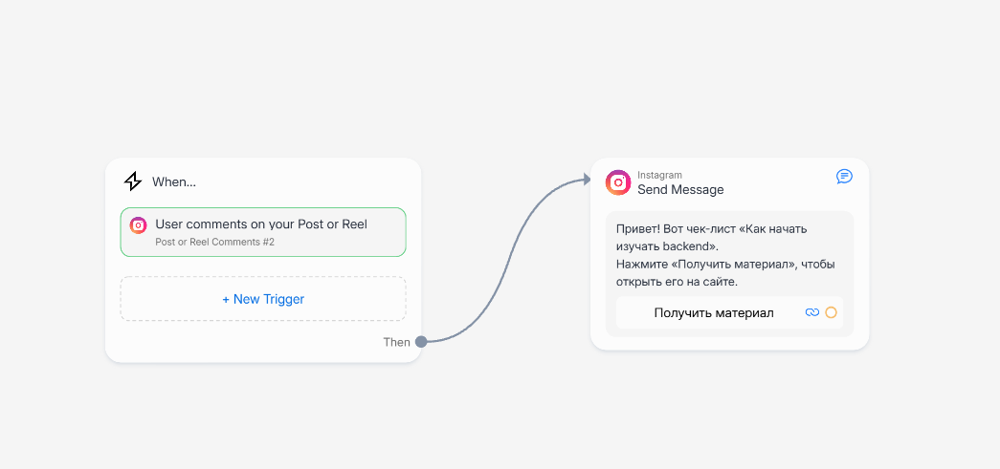
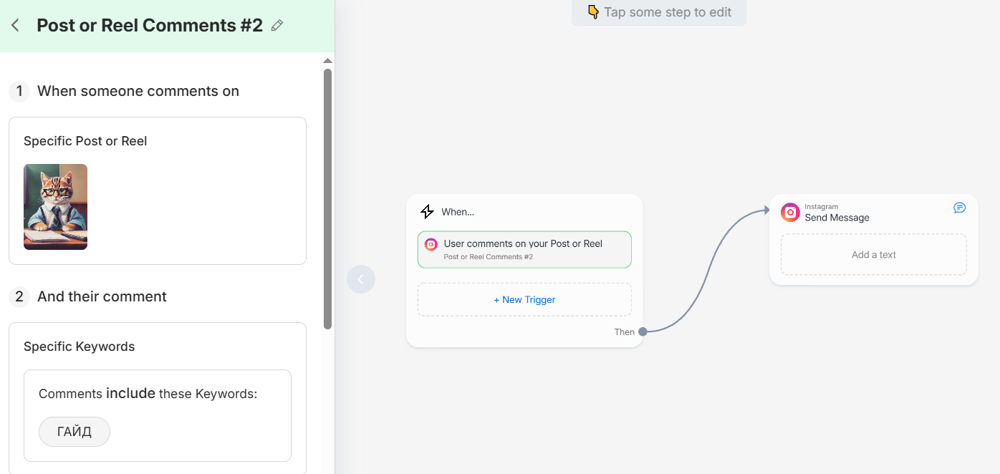
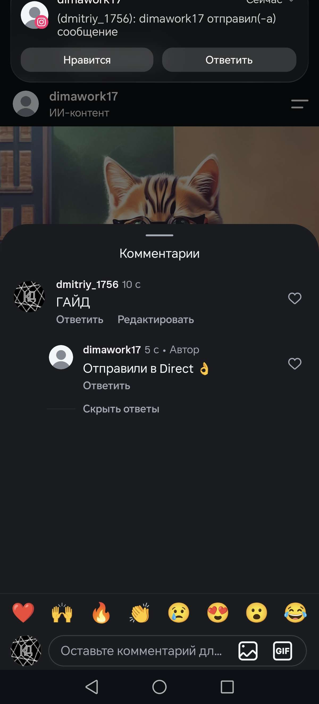
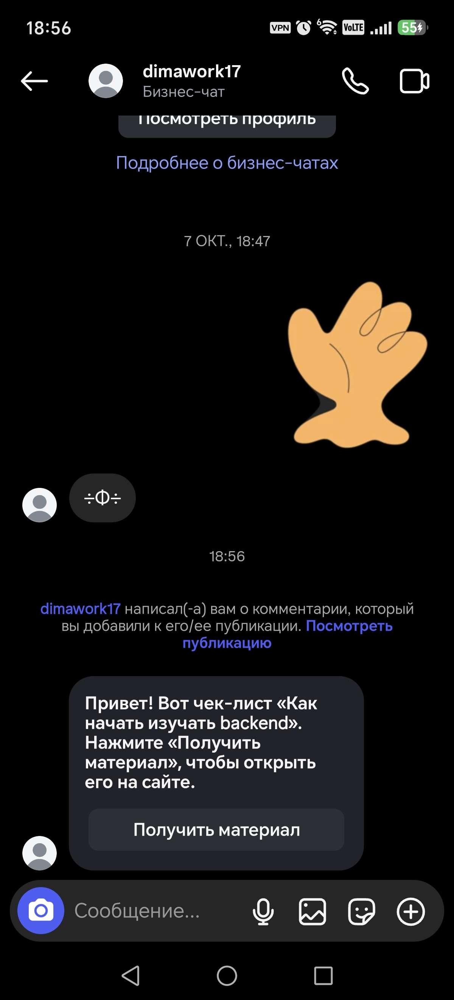
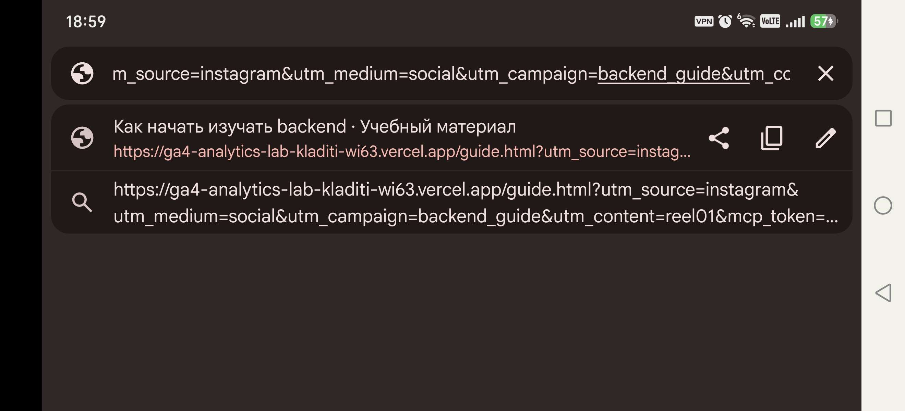
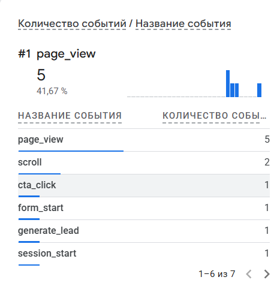
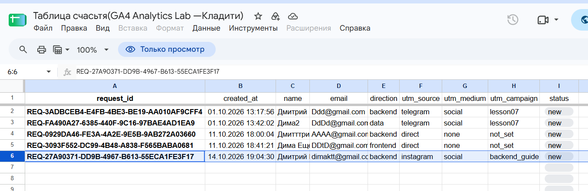

# Домашняя работа № 7 · Instagram → ManyChat → заявка

**Дисциплина:** ОП.03 «Информационные технологии»

| Поле | Значение |
|---|---|
| Фамилия, имя, отчество | Кладити Дмитрий |
| Группа | 11/1-РПО-26/1 |
| Номер работы | 7 |
| Тема работы | Автоворонка из Instagram: комментарий → сообщение → сайт → заявка |
| Дата сдачи | 14.10.2026 |
| Ветка | `hw-07` |

Текст ниже уже написан. Замените `___` своими данными и вставьте кадры
вместо строк «Скриншот: …».

---

## 1. Подключение и automation

Я перевёл учебный аккаунт Instagram в профессиональный и подключил его
к ManyChat на тарифе Free. Собрал automation: триггер на комментарий под
выбранной публикацией, ключевое слово `ГАЙД`, публичный ответ, личное
сообщение и кнопка «Получить материал» со ссылкой с UTM. Automation
включена в режиме Live.

| Мои данные | Значение |
|---|---|
| Учебный аккаунт Instagram | dimawork17 |
| Ссылка на учебную публикацию | https://www.instagram.com/p/DeesJ7iDW0n/ |
| Публичный адрес сайта | https://ga4-analytics-lab-kladiti-wi63.vercel.app |
| Measurement ID (`G-…`) | G-27HDMDLRS1 |

Скриншот: Instagram подключён к ManyChat 

Скриншот: Flow Builder целиком, статус Live 

Скриншот: Триггер: Specific Post и ГАЙД 

## 2. Тест цепочки

Со второго аккаунта dmitriy_1756 я оставил комментарий `ГАЙД`. Под ним появился
автоматический ответ, а в Direct пришло сообщение с кнопкой. Кнопка
открыла `guide.html` с метками в адресе, оттуда я перешёл к форме
и отправил тестовую заявку.

Скриншот: Комментарий и автоматический ответ 

Скриншот: Сообщение в Direct с кнопкой 

Скриншот: guide.html с UTM в адресной строке 

## 3. Результат

В GA4 пришли `page_view` со страницы `guide.html` и `generate_lead`.
В листе `leads` появилась строка с метками `instagram` / `social` /
`backend_guide` и статусом `new`.

`request_id` заявки: ___

Скриншот: page_view и generate_lead в GA4 

Скриншот: Строка заявки из Instagram в листе leads 

---

Не получилось (если всё работает, оставьте пустым): ___

ИИ: не использовал 
